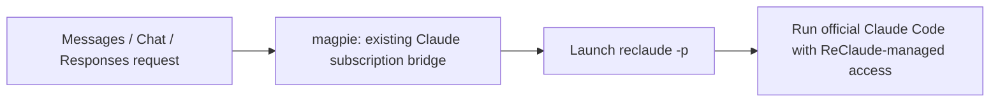

# Local ReClaude bridge: implementation and rationale

Implementation record: 2026-10-22.

Baseline: `4a87c4476dc9de584cf01c801c7909e37e9310a4` in this checkout.
This describes the local, uncommitted patch, not support provided by the
upstream release or a claim about every later GitHub version.

The current runtime contracts belong to the [Claude subscription bridge](subsystems/claude-subscription-bridge.md),
[providers and accounts](subsystems/providers-accounts.md), and
[GUI shell](subsystems/gui-shell.md) references. This note records the
requirements, decisions, maintenance implications, and verification evidence
behind the patch.

## 1. Goal and scope

Use an existing local ReClaude installation as a model source in magpie,
without requiring a separate personal Claude subscription login. Keep the
desktop/Web interface and a persistent source switch. Serve coding agents,
including streaming, tool calls, tool results, and multi-turn conversations,
rather than adding a text-only chat adapter.

The guiding design is to reuse magpie's existing Claude Code bridge and
change account discovery and process selection. No additional HTTP sidecar,
plugin framework, background health loop, or system-wide `claude` replacement
was introduced.

This is a local compatibility integration. The [ReClaude FAQ](https://docs.reclaude.ai/en/help/faq)
lists the official Claude Code clients as supported, but not general
API-key clients. Passing local tests does not make this an officially
supported ReClaude API.

## 2. What upstream already did, and why replacement alone was insufficient

Upstream already ran the genuine `claude -p` process for Claude subscriptions
and translated its output into Messages, Chat Completions, and Responses.
Its bridge already implemented the MCP callback, tool-result handoff,
conversation reuse, streaming, cancellation, and process accounting.

At the baseline, two integration boundaries prevented a ReClaude-only setup
from working as an explicit source:

- **Account discovery:** `claudeAccount` expected a normal Claude sign-in or
  a saved Claude account. A running ReClaude daemon alone did not create
  that provider. The earlier isolated baseline run returned 404 for a
  `claude/*` request because no Claude provider was discovered.
- **Process selection:** `claudeBinary` looked for Claude Code, not the
  `reclaude` launcher. Replacing that executable does not independently
  solve account discovery, usage attribution, or source isolation.

ReClaude's daemon/control ports are not configured as an OpenAI-compatible
upstream. No Anthropic OAuth credential is fabricated to pass discovery.
Replacing the user's system `claude` binary was avoided because it would
also change other applications and could interfere with the launcher that
needs the real Claude Code binary.

The component-level request path is:



The diagram shows responsibilities, not every function or subprocess call.
Protocol conversion remains magpie's responsibility; ReClaude manages its
own connection and subscription access.

## 3. Decisions and their implementation

### One persistent local switch

`Settings.ReClaude` is false by default. The Providers page and
`magpie accounts reclaude [on|off]` share `provider.SetReClaude`, which uses
the settings package's locked setter and invalidates account caches.
`KeepOwn` preserves this computer's choice during restore/sync, and a
general Settings-page save preserves the field too.

**Why:** a deployable GUI needs a saved, visible choice. An environment-only
switch would not meet that requirement, and two independent switches could
disagree. Checked settings reads also prevent an unknown source choice from
being silently interpreted as permission to use a personal Claude account.

Sources: [settings.go](../internal/settings/settings.go),
[settings/accounts.go](../internal/settings/accounts.go),
[provider/reclaude.go](../internal/provider/reclaude.go),
[gui/api.go](../internal/gui/api.go).

### A synthetic account under the existing provider id

When enabled, the source exposes a runtime account named `ReClaude` under
provider id `claude`, marked by `Account.ReClaude`. Normal Claude accounts
are not selected beside it; their stored records are retained. Turning the
switch off restores normal discovery. Account discovery disabled globally
still takes precedence.

**Why:** preserving `claude/<model>` avoids a second model namespace and
unnecessary agent rewiring. The runtime marker is not a credential. Account
listing, alternate-account selection, and ordinary sign-in operations need
small gates so the gateway cannot silently spend a different account.

Sources: [account.go](../internal/provider/account.go),
[logins.go](../internal/provider/logins.go),
[logins_on.go](../internal/provider/logins_on.go),
[signin.go](../internal/provider/signin.go).

### One launcher and daemon check

`ReClaudeBinary(ctx)` checks the selected source and discovery setting,
finds the launcher, runs `reclaude status`, and requires both
`daemon_running` and `daemon_reachable` to be true. It returns the same
launcher path it checked. The probe honors caller cancellation and has a
five-second timeout. `ReClaudeStatus` maps the result to `{on, ready, why}`
for the UI rather than maintaining another health state.

**Why:** duplicated status parsing, path lookup, and error wrapping make
different entry points disagree. No health cache is needed. `ready` means
the local daemon passed this check; it does not guarantee that a model
request has quota or that the remote service will accept it.

Source: [provider/reclaude.go](../internal/provider/reclaude.go).

### One place for the subprocess environment differences

The per-call `WithReClaude` context selects `claudeBinaryFor` and the
ReClaude branch of `claudeCLI.proxied`. Normal turns, model probes, and
`/usage` all use this existing environment entry point. `cleanReClaudeEnv`
filters the environment already prepared by `cleanClaudeEnv`; it does not
prepare the common environment a second time.

The ReClaude branch removes conflicting Claude config-directory overrides
and traffic-disabling variables, and does not inject magpie's configured
provider/global proxy. The ordinary Claude branch retains its original
proxy and `/usage` environment handling.

**Why:** a process-wide switch at `claudeBinary` would also affect unrelated
Claude operations. Three separately maintained environment branches would
drift. The distinction is carried per request, while the actual command
arguments and protocol bridge stay shared.

Sources: [claude_subscription.go](../internal/gateway/claude_subscription.go),
[gateway/claude_warmup.go](../internal/gateway/claude_warmup.go),
[claude_probe.go](../internal/provider/claude_probe.go).

### Checks at the request and subprocess boundaries

`serveClaudeSubscription` validates the selected account before entering
the common bridge and reuses the returned config directory. A new
ReClaude subprocess validates again after waiting for a process slot.
The run owner includes a ReClaude-specific suffix, so a personal account
with the same display name does not resume its conversation process.

**Why:** tool results can match an existing run and call `continueWith`
without entering the `start` closure. A check only in `start` misses that
path. Conversely, the source can be turned off while a new process waits
for capacity. These checks protect different boundaries; they are not
redundant consecutive checks that can simply be deleted.

The `match`, `continueWith`, MCP callback, and session algorithms were not
rewritten. Existing process limits and cleanup mechanisms are reused.

### Usage follows the same source

Model tests and allowance reads use the ReClaude launcher too. Only the
synthetic account bypasses the normal Claude OAuth prerequisites and
personal-account identity comparison. Failed reads remain unknown rather
than becoming zero usage or borrowing a personal account's reading.
Existing successful-run rate-limit events remain attributed to ReClaude.
Automatic Claude warm-up does not run on this source.

**Why:** inference through one account and quota checks through another
would mislead both the user and routing. Automatic warm-up would also
spend subscription quota without a user request.

Sources: [subscription_usage.go](../internal/provider/subscription_usage.go),
[login_usage.go](../internal/provider/login_usage.go),
[quota_last.go](../internal/provider/quota_last.go),
[provider/claude_warmup.go](../internal/provider/claude_warmup.go).

### Keep the interface small

The existing Providers page has one source switch, including when no
provider exists, and displays daemon failures. The synthetic account does
not offer normal Claude OAuth account-management actions. The existing
`GET /api/providers` carries status; `POST /api/providers/reclaude` saves
the switch. The switch button is re-enabled in `finally` after both
successful and failed saves, allowing repeated use without a page reload.

**Why:** desktop and Web already share this page. There is no need for a
new frontend, new settings page, or separate account-management workflow.

Sources: [gui/providers.go](../internal/gui/providers.go),
[app.js](../internal/gui/assets/app.js),
[index.html](../internal/gui/assets/index.html),
[i18n.js](../internal/gui/assets/i18n.js),
[accounts_cli.go](../internal/cli/accounts_cli.go).

## 4. What "simplified" does and does not mean

The simplification consolidated repeated environment handling and health
checks. It did not reduce the integration to a binary rename, and did not
demonstrate an absolute minimum patch.

Before adding this implementation note, the complete local patch touched
29 files: 21 runtime/UI files, five test files, and three subsystem docs.
It added 1,052 lines and removed 48. Runtime/UI accounted for 459 additions
and 46 removals; tests accounted for 549 additions. These are a dated
snapshot, not a size budget or the totals after this document is added.

There is still a meaningful upstream merge surface: 20 existing runtime/UI
files were touched. In particular, `app.js`, `settings.go`, account/login
handling, and the Claude bridge are shared with upstream development.
Most new test code lives in independent files and is less likely to cause
merge conflicts. Line count alone does not represent maintenance cost.

## 5. Verification record

### Passed on the final simplified implementation

- Focused Go tests with `-race`, including caller cancellation, account
  isolation, unavailable daemon, disabled source, queued starts, and tool
  results that would otherwise bypass the request-entry check.
- 57 browser checks across Chromium and WebKit, English, Simplified Chinese,
  Traditional Chinese, Japanese, and German. This includes the ReClaude
  switch, repeated toggles, save-failure recovery, account discovery, and
  translation-key checks. The working browser setup used Playwright 1.58.2.
- macOS vet and native desktop build; Linux and Windows cross-vet/build.
  Cross-building is not runtime testing on those operating systems.
- A separate built gateway with temporary HOME/config and separate ports:
  authenticated Web access, model listing, ReClaude state, and `/usage`.
- A real Messages API tool roundtrip: the model requested `echo_probe`, the
  client returned a new marker, and the model received that result and
  finished its reply. Both requests returned 200 and were attributed to
  ReClaude. The tool performed no file, command, or network operation.

The first live tool attempt returned 429. An allowance-only check showed
remaining quota, and one later controlled attempt completed the roundtrip.
The reason for the first 429 was not established; no automatic retry
mechanism was added to hide it.

The earlier implementation also passed live non-streaming Messages, Chat
Completions, and Responses smoke checks, plus a Messages SSE check. That
earlier evidence is not a claim that every protocol/tool combination was
retested against the real service after the final refactor.

### Failures and limitations that must remain visible

- The final full `go test -tags nogui -timeout 45m ./...` run failed in
  `internal/gui`, at `TestProxyCheckSaysAProxyPassedBy`, with HTTP 502.
  Other packages, including gateway and provider, passed that run.
- That proxy test initially failed 20 isolated `-race` repetitions too.
  Later, both the untouched local baseline and the modified tree passed
  20 equivalent repetitions; the entire GUI Go package subsequently
  passed under `-race`. No proxy implementation fix was made. The cause
  remains unconfirmed, and later passes do not make the earlier full run
  green or establish that it was unrelated to this patch.
- The complete browser regression suite was not run. Native desktop
  windows were built but not opened for runtime validation. Linux/Windows
  ReClaude execution and long-running/high-concurrency behavior were not
  validated by these checks.

The new checks were also tested for their ability to fail: the old button
handling failed the re-enable assertion, the old probe ignored a canceled
caller, and temporarily bypassing the request-entry guard made tool results
reach an unavailable source. All temporary bypasses were restored.

Reusable regression sources:
[provider/reclaude_test.go](../internal/provider/reclaude_test.go),
[gateway/reclaude_test.go](../internal/gateway/reclaude_test.go),
[gui/reclaude_test.go](../internal/gui/reclaude_test.go),
[settings_keep_test.go](../internal/gui/settings_keep_test.go), and
[reclaude-source.test.cjs](../internal/gui/tests/reclaude-source.test.cjs).

Run Go verification with an isolated HOME and the original GOPATH,
GOMODCACHE, and GOCACHE pinned, as required by the
[code standards](code-standards.md#acceptance-criteria). The live checks
reused the existing ReClaude daemon through a temporary link to its state
directory; no credentials were copied or printed. Temporary gateways were
stopped and their temporary HOME directories removed.

## 6. Local operation and deployment boundaries

ReClaude must already be installed, signed in, and able to reach its daemon.
The magpie switch does not install ReClaude or sign in automatically.

For a Web deployment built on macOS, run from the repository root:

```sh
go build -p "$(sysctl -n hw.logicalcpu)" -tags nogui -o ./magpie .
./magpie accounts reclaude on
MAGPIE_ADDR=127.0.0.1:3427 ./magpie serve --web=127.0.0.1:3430
```

`nogui` omits the native desktop host, not the browser interface. The
existing native desktop build remains available through the normal build
instructions. The Providers switch and `./magpie accounts reclaude off`
both restore normal Claude discovery for subsequent requests.

- API base: `http://127.0.0.1:3427/v1`.
- Web page: `http://127.0.0.1:3430`; use the login link printed at startup.
  Do not commit or share its run key.
- Web authentication and gateway authentication are different. This patch
  does not change upstream's permissive loopback API-key behavior; the
  placeholder `magpie` is not a password protecting local API calls.
- The local instance started during this work is a test deployment of a
  built binary, not a packaged release or an installed autostart service.

Starting against a real HOME also starts upstream account discovery and
maintenance for other subscriptions. An earlier run discovered a legacy
Kiro sign-in artifact and installed its community plugin. That was not
part of ReClaude's bridge, and the migration code was not changed here.
Use isolated configurations for automated verification; do not assume
that `serve` has no effect on existing local provider state.

## 7. Updating from upstream

Keep the ReClaude-specific policy concentrated in
`internal/provider/reclaude.go`; leave the wire protocols and tool/session
algorithms owned by the upstream bridge. After a merge, review these
boundaries rather than mechanically reapplying old line numbers:

1. Local settings preservation and the GUI/CLI setter still agree.
2. Account discovery, alternate accounts, and sign-in actions still
   respect the selected source and global discovery setting.
3. Turns, model tests, and allowance reads still select the same launcher
   and share the subprocess environment entry point.
4. Tool-result continuations still pass the entry check, and queued
   ReClaude starts still check after the capacity wait.
5. Run ownership keeps ReClaude and ordinary Claude conversations apart.
6. Quota failures remain unknown; no personal reading is reassigned to
   the synthetic account.
7. The Providers switch works repeatedly in both browser engines and
   remains consistent after errors and general Settings saves.

Run the regression and full checks on the actual merged tree. Do not
present the patch as release-ready until unresolved test failures are
understood. Installing an upstream binary does not include this local
patch; deployment updates must deliberately preserve the custom build.
